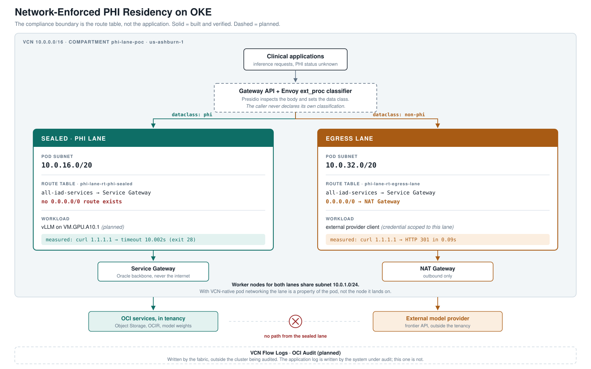

# OKE PHI Lane

**Network-enforced PHI residency for LLM inference on Kubernetes.**

A reference implementation of a data-class boundary enforced by network topology
rather than by application convention. Protected health information cannot reach
an external model provider because no route exists — not because code declined to
send it.

## Verified

Two pods from the same manifest, same image, same namespace. No NetworkPolicy on
either. Both subnets' security lists permit all outbound TCP. The connection uses
a raw IP, so DNS plays no part.

```
egress lane   →  1.1.1.1   HTTP 301 in 0.091893s
PHI lane      →  1.1.1.1   timeout at 10.002612s   (curl exit 28)
```

The only difference between them is which subnet the pod's VNIC came from, and
therefore which route table it inherited. Nothing denied the second request. No
policy evaluated and rejected it, no firewall logged a violation, and no audit
entry records a blocked attempt — because nothing was blocked.

## The problem

Kubernetes has no primitive for data-class boundaries.

`NetworkPolicy` expresses which pod may talk to which pod. It cannot express
which *class of data* may leave the tenancy. In most healthcare AI platforms that
decision lives in application code, in a model endpoint a developer chose. That
is a convention, not a control. One bad merge makes it a reportable breach.

## The approach

Enforcement is layered. Each layer reduces how often a violation is attempted.
Only the last one changes what is possible.

| Layer | Mechanism | Can the workload bypass it? |
|---|---|---|
| Classification | Envoy external processor at the gateway | No. Runs on the trust boundary, not in the caller. |
| Routing | Gateway API Inference Extension pools | No. Declarative, admission-controlled. |
| Cluster network | NetworkPolicy | Advisory. Enforced by the cluster under audit. |
| Credential | Workload identity scoped per lane | No. The PHI lane cannot obtain the external key. |
| Substrate | Pod subnet route table with no internet path | No. There is nowhere for the packet to go. |
| Evidence | VCN flow logs, outside the cluster | No. Written by the fabric, not the application. |

The design principle: **any control the workload can bypass is not a control.**

## Architecture



Detail in [docs/architecture.md](docs/architecture.md).

The load-bearing choice is VCN-native pod networking. Each pod receives its own
VNIC in a pod subnet chosen per node pool, so the lane is a property of the
**pod**, not the node it lands on — worker nodes for both lanes share one subnet.
On an overlay CNI, pods inherit the node's egress path and the same isolation
would need a separate node pool per lane.

## Components

| Function | Project / primitive |
|---|---|
| Ingress and routing | Gateway API, Envoy Gateway |
| Inference routing | Gateway API Inference Extension |
| PHI classification | Microsoft Presidio, via Envoy ext_proc |
| In-tenancy inference | vLLM on GPU node pool |
| Deploy-time guardrails | Kyverno |
| Telemetry | OpenTelemetry, Prometheus |
| Lane isolation | OKE pod subnets, route tables, NSGs |
| Credential scoping | OKE workload identity |
| Audit evidence | VCN flow logs, OCI Audit |

## Status

| Component | State | Detail |
|---|---|---|
| VCN, subnets, route tables | **Built and verified** | 13 resources; sealed table confirmed at one rule |
| Security lists | **Built** | 5 lists, OKE prerequisites on 6443 and 12250 |
| OKE cluster | **Built** | v1.36.4, enhanced, VCN-native pod networking |
| Dual-lane node pools | **Built** | GPU sealed pool, CPU egress pool |
| Lane isolation proof | **Verified** | measured, see above |
| vLLM in the sealed lane | Planned | makes the lane production-realistic |
| Gateway and classifier | Planned | Gateway API, Envoy ext_proc, Presidio |
| Kyverno admission policy | Planned | makes a cross-lane deployment unschedulable |
| Flow logs and audit | Planned | out-of-band evidence trail |

## Running it

```bash
cd terraform
cp terraform.tfvars.example terraform.tfvars    # fill in tenancy and compartment
terraform init && terraform apply

oci ce cluster create-kubeconfig --cluster-id "$(terraform output -raw cluster_id)" \
  --file "$HOME/.kube/config" --region us-ashburn-1 \
  --token-version 2.0.0 --kube-endpoint PUBLIC_ENDPOINT

kubectl apply -f ../manifests/demo-probes.yaml
../demo/run-demo.sh            # --auto for an unattended recording
```

A GPU shape is not required to reproduce the isolation result. The sealed lane's
guarantee is a property of its subnet, not of what runs there — swap the PHI node
pool to any CPU shape and the measurement is unchanged.

## Findings

[FINDINGS.md](FINDINGS.md) records six issues from the build, including a
verification command that produced a false positive on the sealed route table.
That one is the reason this demo proves the boundary by watching a packet fail
rather than by reading configuration.

## Threat model

[docs/threat-model.md](docs/threat-model.md), including the three scenarios this
design does **not** stop:

- **Classifier false negatives.** Every layer below classification is reached
  only because classification said it was safe to go there.
- **Configuration drift.** The cluster has no awareness of its own topology.
- **Telemetry as an exfiltration path.** A span carrying a request body leaves
  through a channel none of these layers inspect.

## Layout

    terraform/    VCN, subnets, route tables, security lists, cluster, node pools
    manifests/    lane probes; Gateway, InferencePool and Kyverno policies to come
    classifier/   Presidio-based external processor (planned)
    demo/         seven-beat lane isolation demo
    docs/         architecture, threat model, diagram
    FINDINGS.md   what broke, and why

## License

Apache 2.0
