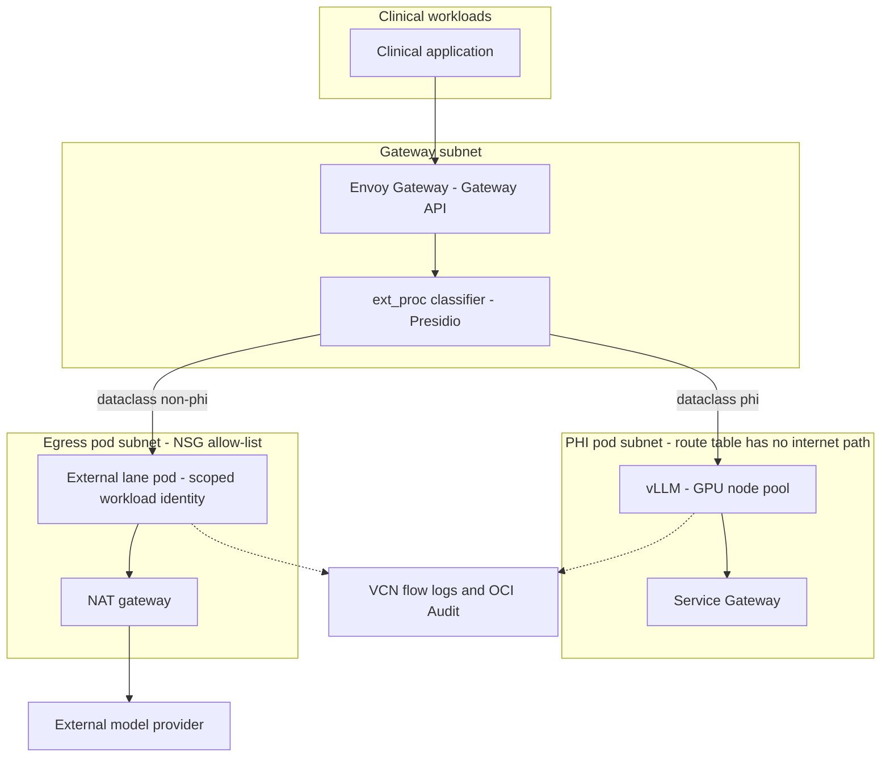

# Architecture

## Request path

## The two lanes

| | PHI lane | External lane |
|---|---|---|
| Pod subnet | Sealed | Egress-capable |
| Route table | No NAT, no internet gateway | NAT gateway |
| Outbound reach | Service Gateway only | NSG allow-list to provider endpoints |
| Inference backend | Self-hosted vLLM on GPU nodes | Third-party frontier model |
| Provider credential | Cannot be obtained | Bound to this lane's service account |
| Node placement | Tainted GPU node pool | General node pool |

## Enforcement points

Classification happens at the gateway, not in the caller. The ext_proc filter
inspects the request body and sets routing metadata. The caller never declares
its own data class, because a caller that can assert its own classification can
lie about it.

Routing is declarative. Each lane is a Gateway API Inference Extension pool, so
the decision is a Kubernetes object a compliance reviewer can read rather than
application code they have to audit.

Admission policy makes violations unschedulable. Kyverno rejects any workload
that would place a PHI-lane pod on an egress-capable node, or mount the external
provider credential outside the egress lane. The misconfiguration fails at
deploy time, not at runtime.

The substrate is the last line and the strongest one. The PHI pod subnet's route
table contains no path to the internet. A PHI-bearing request does not reach an
external provider because there is nowhere for the packet to go. This is the only
layer that holds if every layer above it is misconfigured.

Evidence is written outside the cluster. Application audit logs are produced by
the system under audit. VCN flow logs are produced by the fabric, which is the
distinction that matters to a regulator.

## OKE primitives used

| Function | Primitive |
|---|---|
| Pod-level network identity | VCN-native pod networking |
| Lane isolation | Separate pod subnets and route tables |
| VNIC-level firewall | Network security groups |
| In-tenancy service access without egress | Service Gateway |
| Credential scoping | OKE workload identity to IAM dynamic group |
| Out-of-band evidence | VCN flow logs, OCI Audit |
| Per-pod network separation on shared nodes | Generic VNIC Attachment, where available |

## What this does not do

See [threat-model.md](threat-model.md).
